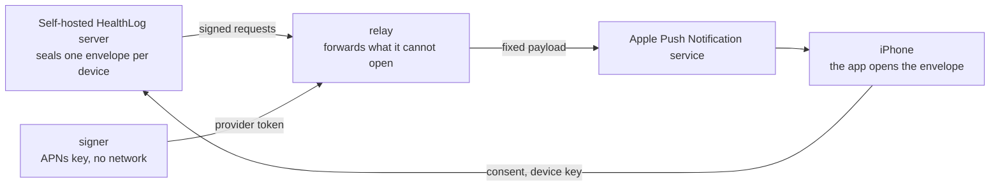

# HealthLog Push Relay

An APNs relay written in Go that carries end-to-end encrypted push notifications, sealed with HPKE, from a
self-hosted [HealthLog](https://healthlog.dev) server to the HealthLog iOS app.

[](https://github.com/MBombeck/healthlog-push/actions/workflows/ci.yml)
[](https://github.com/MBombeck/healthlog-push/actions/workflows/lint.yml)
[](https://github.com/MBombeck/healthlog-push/actions/workflows/codeql.yml)
[](https://scorecard.dev/viewer/?uri=github.com/MBombeck/healthlog-push)
[](https://www.bestpractices.dev/projects/17008)
[](LICENSE)

## What it is

An APNs key belongs to one Apple developer team, so a self-hosted HealthLog server cannot push to the App
Store app by itself. The relay holds that key and passes on what registered servers send to their own
devices, and a self-hoster needs no Apple developer account. It is one Go binary that runs as two processes:
`relay` serves the API and talks to Apple, `signer` holds the APNs key and has no network access. It is not a
medical service: reminders scheduled on the device stay authoritative, and a relayed notification can be
late or lost.

## How privacy works



- **Sealed envelopes.** The server encrypts each notification for one device with HPKE (RFC 9180). The app
  opens it on the device. The relay holds no key that could.
- **Fixed payloads.** The relay builds every APNs payload from constants. A server cannot set visible text.
- **Signed both ways.** Servers sign every request with Ed25519, and the relay signs every response. Servers
  and the app pin the relay's keys at build time.
- **Bindings need the device.** A server that only knows a device token cannot bind it. The app has to sign.
- **Leaving needs nobody.** The app can leave a server directly, and the pair stays blocked for 12 months.

The relay still sees metadata, and time patterns can reveal behaviour. More in
[docs/architecture.md](docs/architecture.md) and [docs/threat-model.md](docs/threat-model.md).

## What the operator sees

The operator never sees medication names, doses, readings, notes, account data or the text of a
notification. What the relay does see and store is published in full, and tests fail when the code and the
lists drift apart: every metric and every request from authorities in
[docs/transparency.md](docs/transparency.md), every stored field and retention period in
[docs/privacy.md](docs/privacy.md).

## Use the hosted relay

`https://push.healthlog.dev` serves the HealthLog app from the App Store. It is free, run by one person on a
best-effort basis, and meant for households. The operator of a HealthLog server switches it on, then each
person consents in their own app. Limits, identity keys and contact addresses are in
[docs/hosted-relay.md](docs/hosted-relay.md), the terms in [docs/terms.md](docs/terms.md).

## Self-host

A relay of your own works only with an app you build and sign under your own Apple developer account. It
cannot serve the App Store app.

```sh
IMAGE=ghcr.io/mbombeck/healthlog-push@sha256:<digest>    # verify it first, see below
docker run --rm "$IMAGE" keygen relay-id                 # pin the publicKey in your app and servers
docker run --rm "$IMAGE" keygen token-mac
docker run --rm "$IMAGE" keygen acme-account

# Put the three keys and your APNs .p8 under /srv/healthlog-push/secrets, then:
cp deploy/compose/compose.yaml /srv/healthlog-push/compose/
cp deploy/compose/.env.example /srv/healthlog-push/compose/.env    # image, host name, APNs topic and ids
cd /srv/healthlog-push/compose && docker compose up -d
docker compose exec relay /healthlog-push healthcheck && echo healthy
```

The relay listens on 8443, so redirect 443 to it. File layout, firewall rules and every setting are in
[docs/self-hosting.md](docs/self-hosting.md), Ansible roles for the host in [deploy/ansible](deploy/ansible/README.md).

## Verify a release

Every release is built from a `vX.Y.Z` tag by the release workflow and signed keyless with cosign. The image
carries an SBOM and SLSA provenance, the binaries a signed checksum file and provenance of their own.

```sh
TAG=vX.Y.Z
IMAGE=ghcr.io/mbombeck/healthlog-push@sha256:<digest>
WORKFLOWS=https://github.com/MBombeck/healthlog-push/.github/workflows
ISSUER=https://token.actions.githubusercontent.com

cosign verify "$IMAGE" \
  --certificate-identity "$WORKFLOWS/release.yml@refs/tags/$TAG" --certificate-oidc-issuer "$ISSUER"
cosign verify-attestation "$IMAGE" --type slsaprovenance1 \
  --certificate-identity "$WORKFLOWS/provenance.yml@refs/tags/$TAG" --certificate-oidc-issuer "$ISSUER" \
  --certificate-github-workflow-repository MBombeck/healthlog-push > /dev/null
cosign verify-blob SHA256SUMS --bundle SHA256SUMS.sigstore.json \
  --certificate-identity "$WORKFLOWS/release.yml@refs/tags/$TAG" --certificate-oidc-issuer "$ISSUER"
```

The SBOM check, the binary provenance and how the pipeline is protected are in
[docs/release-verification.md](docs/release-verification.md).

## Documentation

- [Architecture](docs/architecture.md): the two processes, the privacy properties in full, the code layout
- [Hosted relay](docs/hosted-relay.md): limits, identity keys, contact
- [Self-hosting](docs/self-hosting.md), [operations](docs/operations.md) and [migration](docs/migration.md)
- [API reference](docs/api.md) and the [protocol specification](spec/README.md)
- [Privacy notice](docs/privacy.md), [terms](docs/terms.md) and [transparency](docs/transparency.md)
- [Threat model](docs/threat-model.md), [security invariants](docs/security-invariants.md) and [assurance case](docs/assurance-case.md)
- [Key ceremony](docs/key-ceremony.md), [host hardening](docs/hardening.md) and [release verification](docs/release-verification.md)
- [Governance](GOVERNANCE.md), [maintainers](MAINTAINERS.md), [roadmap](docs/roadmap.md), [continuity](docs/continuity.md), [dependencies](docs/dependencies.md) and [changelog](CHANGELOG.md)

## Security

Report a vulnerability privately, as described in [SECURITY.md](SECURITY.md).

## Contributing

[CONTRIBUTING.md](CONTRIBUTING.md) covers building, tests, the sign-off and the text rules.

## License

[Apache-2.0](LICENSE) for the code. Everything under `spec/` is public domain under CC0 1.0 ([spec/LICENSE](spec/LICENSE)).

Support the project: [♥ Sponsor on GitHub](https://github.com/sponsors/MBombeck) or [buy me a coffee](https://buymeacoffee.com/mbombeck)
