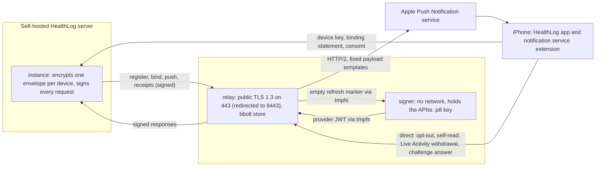

# healthlog-push: end-to-end encrypted APNs push relay for self-hosted HealthLog

[](https://github.com/MBombeck/healthlog-push/actions/workflows/ci.yml)
[](https://github.com/MBombeck/healthlog-push/actions/workflows/ci.yml)
[](https://github.com/MBombeck/healthlog-push/actions/workflows/codeql.yml)
[](https://scorecard.dev/viewer/?uri=github.com/MBombeck/healthlog-push)
[](https://www.bestpractices.dev/projects/17008)
[](LICENSE)

healthlog-push is a push relay written in Go. It lets a self-hosted [HealthLog](https://healthlog.dev) server
send push notifications to the HealthLog iOS app through Apple Push Notification service (APNs), so a
self-hoster does not need an Apple developer account. Every notification is end-to-end encrypted: the server
seals it for one device with HPKE, and the relay forwards an envelope it has no key for. The relay keeps only
the metadata it needs to address devices and enforce limits. What it stores and what its operator can see is
published in full, and tests fail when the code and the published lists drift apart.

A hosted relay for households runs at `https://push.healthlog.dev`. You can also run your own for an app you
build yourself.

## What it is

An APNs key belongs to one Apple developer team, and a device token works only with the key of the team that
signed the app. A self-hosted HealthLog server therefore cannot push to the App Store app by itself. The
relay holds the APNs key for that app and passes on what registered servers send to their own devices.

It is one Go binary that runs as two processes. `relay` serves the API and talks to Apple. `signer` holds the
APNs key, has no network access, and hands the relay a short-lived provider token through a shared tmpfs.

The relay is not a medical service. Reminders that the app schedules on the device stay the authoritative
reminder path. A notification sent through the relay can be late or lost.

## How the privacy works




- **Sealed envelopes.** The HealthLog server encrypts each notification for one device with HPKE (RFC 9180) in
  auth mode: DHKEM(X25519, HKDF-SHA256), HKDF-SHA256 and ChaCha20-Poly1305. The app's notification service
  extension opens it on the device. The relay never holds a key that opens an envelope
  ([spec/envelope.md](spec/envelope.md)).
- **Fixed payloads.** The relay builds every APNs payload from constants. A server chooses the class, the
  envelope, the lifetime and a collapse id. It cannot set visible text, a category or `userInfo` keys.
- **Signed in both directions.** Every request from a server is signed with its Ed25519 key. Every `/v1`
  response is signed with the relay identity key, and the signature covers method, path, the request's
  mandatory nonce, status and body, so an answer cannot be replayed onto another request.
- **Pinned keys.** HealthLog servers and the app pin the relay's public identity keys at build time and
  never fetch them from the relay, because an answer cannot vouch for the key that signs it. Three keys are
  pinned: `current`, `next` for a planned rotation, and a separately held `emergency` key
  ([Hosted relay identity keys](#hosted-relay-identity-keys)).
- **Bindings need the device.** A device binding needs a statement signed by a key that only the app holds. A
  server that merely knows a device token cannot bind it.
- **Leaving needs nobody's help.** The app can leave a server directly (`DELETE /v1/bindings/self`). The pair
  is then blocked for 12 months, and only the same device can lift the block with a newly signed binding
  statement. The binding key stays pinned to the token for the same time, so another server cannot bind the
  token without a challenge that only the device can answer.

What the design cannot do is stated just as plainly. The relay sees metadata, and time patterns can reveal
health behaviour, for example when a dose was recorded on another device. Whoever holds the APNs key (the
operator, or someone who compromises the signer or the host) can put a plaintext alert on a device whose
token they have seen; they cannot read any data, and the app takes no action on a notification it could not
decrypt and verify. A Live Activity cannot decrypt anything, so its fixed set of state fields travels in the
clear, and only after a separate consent in the app. DNS or TLS takeover becomes an outage, because responses
are signed. Nobody can prove which code runs on a server they do not control. The full analysis is in
[docs/threat-model.md](docs/threat-model.md).

## What the operator can see

The privacy notice in [docs/privacy.md](docs/privacy.md), also served at `/privacy`, is the single source for
what the relay sees and stores and for every retention period. In short:

- **Never:** medication names, doses, readings, notes, account data, the host name of a HealthLog server, or
  any plaintext of a notification.
- **While a request is processed:** the device token, and the class, lifetime, size and time of a
  notification. IP addresses are held in memory for the connection and registration limits and are neither
  stored nor logged.
- **At rest:** an HMAC of the device token, the server's instance id and public key, a hash of the app's
  binding key, and day or week numbers. The database holds no time of day and no raw token.
- **Metrics:** exactly the list in
  [docs/transparency.md](docs/transparency.md#metrics-the-operator-sees). A test fails when the code
  registers a metric that is not in that table. No metric is per server, per device or per person, and every
  label comes from a fixed list in the code.
- **Logs:** no access log. Log lines are JSON with a closed set of keys, none of which can hold an address,
  a token or an instance id.
- **Per server:** one view, `admin suspects` on the host's admin socket, for handling abuse. It is shown on
  request and never logged or exported.

The relay only carries what a registered server sends to its own bound devices. The operator never sends
anything through it: no announcements, no update notices, no messages of any kind.

Requests from authorities (none so far), how they are handled, and every key rotation and deprecation are
listed in [docs/transparency.md](docs/transparency.md).

## Using the hosted relay

The hosted relay at `https://push.healthlog.dev` serves the HealthLog app from the App Store. It is free, run
by one person on a best-effort basis, and meant for households: one person or a family running their own
HealthLog server. Organisations run their own relay. The [terms](docs/terms.md) are short.

Using it is voluntary and takes two steps. The operator of a HealthLog server switches the relay on for that
server, then every person decides in their own app. The app creates its keys and asks for a binding only
after that consent.

Contact: relay@healthlog.dev (operation), abuse@healthlog.dev (abuse, suspension appeals),
privacy@healthlog.dev (data protection).

### Limits

Defaults of the hosted relay (`DefaultLimits` in `internal/relay/config.go`, `DefaultRegistrationLimits` in
`internal/limits/limits.go`). Every `429` names its scope (`device`, `activity`, `instance`, `tier` or `global`) and
carries a retry hint spread by plus or minus 30 %: the `retryAfter` field, and on a refusal of the whole
request also the `Retry-After` header. Clients take the hint only from the signed `retryAfter` (capped at one
day), never from the unsigned header. Request-rate and binding-quota refusals include the instance's limits.

| Limit | probation | standard | Refusal |
|---|---|---|---|
| Active device bindings per instance | 20 | 50; 80 automatically after 30 quiet days above 80 % use; up to 150 by the operator | `429 binding_quota` |
| Provisional bindings at the same time | 10 | 20 | `429 binding_quota` |
| New device bindings per day | 20 | 100 | `429 binding_quota` |
| Authenticated requests per minute | 20 | 60 | `429 instance_rate` |
| Pushes per instance per day | 500 | 10,000 | `429 instance_quota` |
| Pushes per instance per minute | 30 | 120 | `429 instance_rate` |
| Invalid tokens per instance per day | 20 | 100 | above it for 24 h: no new bindings, and provisional and soft-invalid bindings get `429 binding_quota` |
| Conflict challenges per instance per day | 20 | 20 | `409 binding_conflict` with reason `challenge_quota` |
| Failed signatures counted in metrics (token bucket, refills per minute) | 30 | 60 | none: limits only the counting, never refuses a request |

| Per device (every tier) | Value | Refusal |
|---|---|---|
| All classes per day | 300 | `429 device_quota` |
| Alerts | bucket of 20, refills 6 per hour, at most 100 per day | `429 device_quota` |
| Silent pushes per hour | 6 | `429 device_quota` |
| Live Activity starts per day (only with the Live Activity consent) | 12 | `429 device_quota` |
| Live Activity updates per activity (only with the Live Activity consent) | 12 per hour, 48 per day | `429 device_quota`, scope `activity` |
| Live Activity ends per day | 12 | `429 device_quota` |
| Soft-invalid binding | no push on the day it failed, then one probe a day | `429 binding_quota`, scope `device` |
| Challenges per token | 1 per token, instance and day | `409 binding_conflict`, `challenge_quota` |
| Verified app calls (opt-out, self-read, Live Activity withdrawal, challenge answer) | bucket of 10, refills 10 per hour | `429 device_quota` |

| Relay-wide | Value |
|---|---|
| Global push limit per minute | 5 times the busiest minute of the last 7 days, at least 600, at most 6,000 |
| Share of the global limit for standard instances | silent 70 %, Live Activity 85 %, alert 100 % |
| Pool of all probation instances per minute | 10 % of the global limit, at least 60, at most 600 |
| Registrations | 3 per day per IPv4 address or IPv6 /64, 10 per IPv6 /48, 30 per hour and 200 per day globally (ten times the global caps during a recovery window) |
| Failed app calls | token bucket of 100, refills 20 per second, shared by all callers; only failed attempts are charged |
| Connections | 2,000 in total, 8 per IPv4 address or IPv6 /64, 64 per IPv6 /48, 16 HTTP/2 streams per connection |
| Request bodies | `Content-Length` required on `POST` and `DELETE` (`411 length_required`); push batch at most 50 items and 128 KiB, other bodies 4 KiB; 32 MiB in flight in total (`503 overloaded`) |
| Response bodies | at most 64 KiB; clients refuse more than 256 KiB |
| Send queue | 4,096 jobs, 256 per instance; an empty queue always admits, otherwise a job is refused when the estimated wait exceeds 2 s |
| Signed time window | plus or minus 300 s |

After a restart, counts held in memory are gone. Until the next UTC midnight the relay therefore halves the
global registration caps and the per-device silent and Live Activity start and end limits; the
per-activity update counts start again from zero. The daily alert count of a
device, the daily push count of an instance and an instance's anomaly flag are stored and survive a restart.
The per-instance counts of new bindings and challenges and the 24-hour block after an exceeded invalid-token
budget do not; see the known limitations in [docs/threat-model.md](docs/threat-model.md#known-limitations).

### Hosted relay identity keys

The public identity keys of `push.healthlog.dev` are unpadded base64url Ed25519 public keys. `current` and
`next` were published with v1.0.0, `emergency` with v1.0.2, each in the release notes and in
[`keys/push.healthlog.dev.json`](keys/push.healthlog.dev.json) in the tagged tree. The HealthLog server ships
them as its hosted relay pins, the iOS app as its `HLPushRelayKeys` build setting.

| Key | Ed25519 public key (base64url) |
|---|---|
| `current` | `IU8JGZzcE-O4gp4q2BL2o6YYNJeHyDg8MNmAGL5_Ypo` |
| `next` | `kPhnCqIwrF_cyQIFTAgCHrWnPavdWkcwMB35oi_wCH0` |
| `emergency` | `dcrihMfqGY7srT95DZrVP7sKA-IS3oJPPhOVbbqTvBU` |


`emergency` is held separately from the relay host and from the operational keys and is never deployed to
the relay. It is used only if both other keys are lost
([docs/key-ceremony.md](docs/key-ceremony.md#lost-current-and-next)).

A new `next` key is published in the release notes of the release that ships it, before the relay switches
to it. Rotations are announced in [docs/transparency.md](docs/transparency.md) at least 7 days before the
relay signs with the new key. How the keys are made, kept and rotated is in
[docs/key-ceremony.md](docs/key-ceremony.md) and [docs/operations.md](docs/operations.md#relay-identity-key).

## Self-hosting quick start

A self-hosted relay works only with an app you build yourself under your own Apple developer account. It
cannot serve the App Store app. Read [docs/self-hosting.md](docs/self-hosting.md) first; this is the short
version. Host provisioning with Ansible is described in [deploy/ansible/README.md](deploy/ansible/README.md).

1. Pick a released image by digest and verify it (see [Verifying a release](#verifying-a-release)):

   ```sh
   IMAGE=ghcr.io/mbombeck/healthlog-push@sha256:<digest>
   ```

2. Generate the keys:

   ```sh
   docker run --rm "$IMAGE" keygen relay-id      # JSON: relay_id_key (secret) and publicKey (pin this)
   docker run --rm "$IMAGE" keygen token-mac     # base64url, 32 bytes
   docker run --rm "$IMAGE" keygen acme-account  # PEM, EC P-256
   ```

   Keep all three in your secret store. The file `relay_id_key` holds only the value of the
   `relay_id_key` field, not the whole JSON line.

3. Lay out the secrets and state directories:

   ```
   /srv/healthlog-push/secrets/relay/relay_id_key            owner 65532, mode 0400
   /srv/healthlog-push/secrets/relay/token_mac_key           owner 65532, mode 0400
   /srv/healthlog-push/secrets/relay/token_mac_key_previous  optional, only during a rotation
   /srv/healthlog-push/secrets/relay/acme_account_key        owner 65532, mode 0400
   /srv/healthlog-push/secrets/signer/apns.p8                owner 65533, mode 0400
   /srv/healthlog-push/data                                  65532:65530, 0700 (database, admin socket)
   /srv/healthlog-push/export                                65532:65530, 0750 (daily registry.json)
   /srv/healthlog-push/acme                                  65532:65530, 0700 (certificate cache)
   ```

4. Copy `deploy/compose/compose.yaml` and `deploy/compose/.env.example` (as `.env`) to
   `/srv/healthlog-push/compose/`, fill in `HLP_IMAGE`, `HLP_IMAGE_DIGEST`, `HLP_PUBLIC_HOST`,
   `HLP_APNS_TOPIC`, `HLP_APNS_KEY_ID` and `HLP_APNS_TEAM_ID`, then:

   ```sh
   cd /srv/healthlog-push/compose && docker compose up -d
   docker compose exec relay /healthlog-push healthcheck && echo healthy
   ```

5. The relay listens on 8443 with host networking and no capabilities. Redirect 443 to it, for IPv4 and
   IPv6, and accept 8443 only for redirected connections:

   ```
   table inet hlp {
     chain prerouting { type nat hook prerouting priority dstnat; policy accept;
       tcp dport 443 redirect to :8443 }
     chain input { type filter hook input priority filter; policy drop;
       iif "lo" accept
       ct state established,related accept
       tcp dport 8443 ct status dnat accept
       # plus ICMP, ICMPv6 and your management access
     }
   }
   ```

   The certificate comes from Let's Encrypt over TLS-ALPN-01 on port 443 once DNS points at the host.
   The complete rule set is `deploy/ansible/roles/firewall/templates/nftables.conf.j2`.

## Verifying a release

Releases are built by `.github/workflows/release.yml` from a `vX.Y.Z` tag. The image is signed keyless
with cosign, carries an SPDX SBOM attestation and SLSA provenance, all in the Sigstore bundle format that
cosign 3 reads without extra flags. Verify before you run it (v1.0.0 differs, see
[docs/release-verification.md](docs/release-verification.md#v100)):

```sh
IMAGE=ghcr.io/mbombeck/healthlog-push@sha256:<digest>
TAG=vX.Y.Z

cosign verify "$IMAGE" \
  --certificate-identity "https://github.com/MBombeck/healthlog-push/.github/workflows/release.yml@refs/tags/$TAG" \
  --certificate-oidc-issuer https://token.actions.githubusercontent.com

cosign verify-attestation "$IMAGE" --type slsaprovenance1 \
  --certificate-identity "https://github.com/MBombeck/healthlog-push/.github/workflows/provenance.yml@refs/tags/$TAG" \
  --certificate-oidc-issuer https://token.actions.githubusercontent.com \
  --certificate-github-workflow-repository MBombeck/healthlog-push > /dev/null

cosign verify-attestation "$IMAGE" --type spdxjson \
  --certificate-identity "https://github.com/MBombeck/healthlog-push/.github/workflows/release.yml@refs/tags/$TAG" \
  --certificate-oidc-issuer https://token.actions.githubusercontent.com > /dev/null
```

The GitHub release also carries static Linux binaries for amd64 and arm64 with a signed checksum file:

```sh
cosign verify-blob SHA256SUMS --bundle SHA256SUMS.sigstore.json \
  --certificate-identity "https://github.com/MBombeck/healthlog-push/.github/workflows/release.yml@refs/tags/$TAG" \
  --certificate-oidc-issuer https://token.actions.githubusercontent.com
sha256sum -c SHA256SUMS --ignore-missing
```

From v1.0.3 on the release also carries SLSA provenance for the binaries and `SHA256SUMS`
(`healthlog-push_$TAG.intoto.jsonl`), checked with `slsa-verifier verify-artifact`; the commands are in
[docs/release-verification.md](docs/release-verification.md).

The hosted relay reports its version, commit and image digest at `https://push.healthlog.dev/version`.
That answer comes from the server being checked, so it is a statement, not proof.

[docs/release-verification.md](docs/release-verification.md) walks through checking a release end to end
and describes how the build pipeline is protected. The pipeline can be rehearsed locally, with a throwaway
registry and key, with `scripts/release-dry-run.sh`.

## Security

Report a vulnerability privately, by email to relay@healthlog.dev or through GitHub's private vulnerability
reporting. [SECURITY.md](SECURITY.md) has the scope and what to expect.

- [docs/threat-model.md](docs/threat-model.md): assets, actors and known limitations
- [SECURITY-INVARIANTS.md](SECURITY-INVARIANTS.md): every security invariant and the tests that fail when it breaks
- [docs/key-ceremony.md](docs/key-ceremony.md): how the identity, MAC and APNs keys are made, kept and rotated
- [docs/hardening.md](docs/hardening.md): how the host of the hosted relay is hardened
- [docs/transparency.md](docs/transparency.md): authority requests, the metric list, rotations and deprecations
- [docs/assurance-case.md](docs/assurance-case.md): why the design meets its security requirements, with the evidence

## Contributing

[CONTRIBUTING.md](CONTRIBUTING.md) explains how changes reach `main`, what a test has to prove, the sign-off
and the text rules. How decisions are made is in [GOVERNANCE.md](GOVERNANCE.md), who holds which role in
[MAINTAINERS.md](MAINTAINERS.md), the direction in [ROADMAP.md](ROADMAP.md), and what happens if the
maintainer is gone in [CONTINUITY.md](CONTINUITY.md). You need the Go version named in `go.mod` and Node 22 for the vector check.

```sh
go build ./...
go vet ./...
go test -race ./...
golangci-lint run                                        # v2, config in .golangci.yml
go run golang.org/x/vuln/cmd/govulncheck@v1.10.0 ./...
node spec/tools/check-vectors.mjs
scripts/check-text.sh
docker build -t healthlog-push:dev .
```

Fuzz targets run for 20 seconds each in CI; see [CONTRIBUTING.md](CONTRIBUTING.md) for running one
locally. Dependencies and the policy for adding one: [docs/dependencies.md](docs/dependencies.md).

### Project layout

```
cmd/healthlog-push/    entry point: relay, signer, admin, keygen, healthcheck, version
internal/relay/        HTTP API, bindings, push path, limits, breaker, maintenance, admin socket
internal/wire/         every parser and every signed text of the protocol (fuzzed)
internal/apns/         APNs client and the fixed payload templates
internal/signer/       the network-less signer that writes provider JWTs
internal/store/        bbolt persistence, retention, registry export
internal/limits/       token buckets, windows, registration and connection limiters
internal/queue/        fair, bounded in-memory send queue
internal/logx/         the only logger: JSON lines with a closed set of keys
internal/metrics/      coarse Prometheus counters without instance labels
internal/notice/       the texts served at /privacy, /terms, /.well-known/security.txt and /
internal/admin/        operator command line over the admin socket
spec/                  protocol specification, test vectors and their tools
deploy/compose/        compose file for relay and signer
deploy/ansible/        host provisioning and verified deployment
keys/                  the published identity keys of the hosted relay, checked by a test
docs/                  operations, privacy, terms, threat model, self-hosting, API, dependencies, migration
structure_test.go      structural rules about the code base itself
```

### Documentation

- [docs/operations.md](docs/operations.md): deploy, rollback, admin commands, key rotation, alerts, runbooks
- [docs/self-hosting.md](docs/self-hosting.md): running your own relay for your own app build
- [docs/api.md](docs/api.md): API reference with examples; the contract is `spec/protocol.md` and `spec/relay-api.yaml`
- [docs/release-verification.md](docs/release-verification.md): verifying a release and rehearsing one locally
- [docs/privacy.md](docs/privacy.md) and [docs/terms.md](docs/terms.md): the texts of the hosted relay
- [docs/migration.md](docs/migration.md): moving the relay to a new host
- [docs/dependencies.md](docs/dependencies.md): every module and why it is there

## License

The code is licensed under the [Apache License 2.0](LICENSE). Everything under `spec/`, the specification,
the test vectors in `spec/vectors/` and their tools, is dedicated to the public domain under CC0 1.0
([spec/LICENSE](spec/LICENSE)), so that other implementations can copy it without conditions. The HealthLog server
and apps are separate projects under their own licenses.
