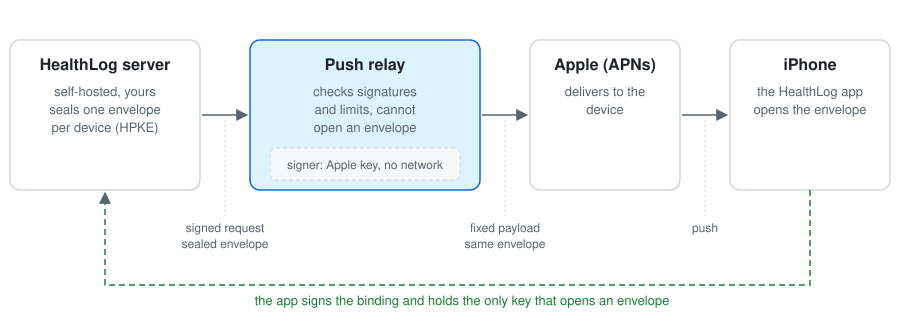

# HealthLog Push Relay

Carries end-to-end encrypted push notifications from a self-hosted [HealthLog](https://healthlog.dev)
server to the HealthLog iOS app, without being able to read them.

[](https://github.com/MBombeck/healthlog-push/actions/workflows/ci.yml)
[](https://scorecard.dev/viewer/?uri=github.com/MBombeck/healthlog-push)
[](https://www.bestpractices.dev/projects/17008)
[](LICENSE)

<picture>
  <source media="(prefers-color-scheme: dark)" srcset="docs/images/relay-dark.svg">
  
</picture>

## What it is

Apple lets only the holder of an app's APNs key push to that app, so a self-hosted server cannot reach the
App Store app on its own. The relay holds that key and forwards what registered servers send to devices
that agreed to it. It is one Go binary in two processes: `relay` serves the API and talks to Apple,
`signer` holds the Apple key and has no network access. A third, `wallet`, off until a certificate is
configured, signs Apple Wallet passes of a server's emergency card without seeing them: the server sends
only the list of file hashes ([spec/wallet.md](spec/wallet.md)).

## What the relay can and cannot see

| The relay sees | The relay never sees |
|---|---|
| a keyed hash of each device token; the token itself only while a request is processed | the text of a notification, medication names, doses, readings, notes |
| a random id and public key for each HealthLog server | names, accounts, e-mail addresses, the host name of your server |
| the class, lifetime and fixed size of each notification, and when it passed | the key that opens an envelope: it exists only on the device |
| IP addresses, in memory for rate limits only | any stored or logged IP address, and any time of day in its database |

Time patterns can still say something about health, which the [privacy notice](docs/privacy.md) states
openly together with every stored field and how long it is kept. Every metric the operator sees is listed
in [transparency.md](docs/transparency.md), and tests fail when code and lists drift apart.

## Only for HealthLog

The Apple topic is fixed when the relay starts and every payload is built from constants, so no server can
make the relay deliver to another app or show text of its own. A server can reach a device only after the
HealthLog app on that device has signed a binding with its own key, and the app can leave a server
directly, without that server. A Wallet pass the relay signs carries the HealthLog icon and logo, pinned
by hash; its texts come from the server that built it, which the relay records by manifest hash for 400
days and can block from Wallet.

## Fast from anywhere, hosted in Germany

As far as can be seen from outside, Apple's push API answers from North America, so every push crosses the
Atlantic once, wherever a relay stands. On the hosted relay Apple answered in about 0.13 s at the median
and 0.23 s at the 90th percentile over the week to 2026-11-24 (`hlp_delivery_latency_seconds`, a small
sample). The relay's own work on a push is about 0.3 ms (`BenchmarkPushEndToEnd`, one CPU), and one relay
handles about 1,900 push items per second with Apple at 130 ms (load test; the hosted relay caps itself at
100). Adding the round trip to Frankfurt ([WonderNetwork](https://wondernetwork.com/pings/Frankfurt)), a
HealthLog server in New York gets Apple's answer after about 0.22 s on a warm connection, one in Sydney
after about 0.38 s. Method, commands and every figure: [docs/performance.md](docs/performance.md).

## Verify it yourself

```sh
git clone https://github.com/MBombeck/healthlog-push && cd healthlog-push && scripts/verify-release.sh
```

This asks `https://push.healthlog.dev/version` what it runs, checks the cosign signature on the release
checksums and on the image, its SLSA provenance, rebuilds both binaries from the tagged source, and
compares them byte for byte with the release, with the binary inside the image and with the hash the relay
reports of its own executable. [docs/verify.md](docs/verify.md) explains each step and what it cannot
prove; [docs/release-verification.md](docs/release-verification.md) covers SBOMs and the pipeline.

## Use the hosted relay

`https://push.healthlog.dev` serves the HealthLog app from the App Store. It is free, run by one person on a
best-effort basis, and meant for households. The operator of a HealthLog server switches it on, then each
person consents in their own app. Limits, identity keys and contacts: [docs/hosted-relay.md](docs/hosted-relay.md),
terms: [docs/terms.md](docs/terms.md).

## Run your own

A relay of your own works only with an app you build and sign under your own Apple developer account.

```sh
IMAGE=ghcr.io/mbombeck/healthlog-push@sha256:<digest>    # verify it first, see above
docker run --rm "$IMAGE" keygen relay-id                 # pin the publicKey in your app and servers
docker run --rm "$IMAGE" keygen token-mac
docker run --rm "$IMAGE" keygen acme-account
# Put the three keys and your APNs .p8 under /srv/healthlog-push/secrets, then:
cp deploy/compose/compose.yaml /srv/healthlog-push/compose/
cp deploy/compose/.env.example /srv/healthlog-push/compose/.env    # image, host name, APNs topic and ids
cd /srv/healthlog-push/compose && docker compose up -d
```

The relay listens on 8443, so redirect 443 to it. Keys, file layout, firewall, AppArmor and every setting: [docs/self-hosting.md](docs/self-hosting.md),
Ansible roles: [deploy/ansible](deploy/ansible/README.md), day-to-day: [docs/operations.md](docs/operations.md).

## Documentation

- [Architecture](docs/architecture.md), [API](docs/api.md) and the [protocol](spec/README.md)
- [Threat model](docs/threat-model.md), [security invariants](docs/security-invariants.md), [assurance case](docs/assurance-case.md) and [host hardening](docs/hardening.md)
- [Privacy notice](docs/privacy.md), [transparency](docs/transparency.md) and [performance](docs/performance.md)
- [Verify a release](docs/verify.md), [key ceremony](docs/key-ceremony.md) and [migration](docs/migration.md)
- [Governance](GOVERNANCE.md), [roadmap](docs/roadmap.md), [continuity](docs/continuity.md), [dependencies](docs/dependencies.md) and [changelog](CHANGELOG.md)

## Security, contributing, license

Report a vulnerability privately as [SECURITY.md](SECURITY.md) describes. [CONTRIBUTING.md](CONTRIBUTING.md)
covers building, tests, the sign-off and the text rules. The code is [Apache-2.0](LICENSE); everything under
`spec/` is public domain under CC0 1.0 ([spec/LICENSE](spec/LICENSE)).

Support the project: [♥ Sponsor on GitHub](https://github.com/sponsors/MBombeck) or [buy me a coffee](https://buymeacoffee.com/mbombeck)
