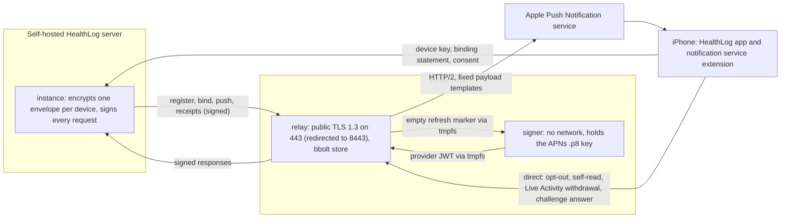

# Architecture

How the relay is built, what each part can and cannot do, and where the code lives. The protocol itself is
specified in [spec/](../spec/README.md); the threats and their limits are in
[threat-model.md](threat-model.md).

## Why a relay

An APNs key belongs to one Apple developer team, and a device token works only with the key of the team that
signed the app. A self-hosted HealthLog server therefore cannot push to the App Store app by itself. The
relay holds the APNs key for that app and passes on what registered servers send to their own devices.

The relay is not a medical service. Reminders that the app schedules on the device stay the authoritative
reminder path. A notification sent through the relay can be late or lost.

## Two processes

It is one Go binary that runs as two processes. `relay` serves the API and talks to Apple. `signer` holds the
APNs key, has no network access, and hands the relay a short-lived provider token through a shared tmpfs.



## Privacy properties

- **Sealed envelopes.** The HealthLog server encrypts each notification for one device with HPKE (RFC 9180) in
  auth mode: DHKEM(X25519, HKDF-SHA256), HKDF-SHA256 and ChaCha20-Poly1305. The app's notification service
  extension opens it on the device. The relay never holds a key that opens an envelope
  ([spec/envelope.md](../spec/envelope.md)).
- **Fixed payloads.** The relay builds every APNs payload from constants. A server chooses the class, the
  envelope, the lifetime and a collapse id. It cannot set visible text, a category or `userInfo` keys.
- **Signed in both directions.** Every request from a server is signed with its Ed25519 key. Every `/v1`
  response is signed with the relay identity key, and the signature covers method, path, the request's
  mandatory nonce, status and body, so an answer cannot be replayed onto another request.
- **Pinned keys.** HealthLog servers and the app pin the relay's public identity keys at build time and
  never fetch them from the relay, because an answer cannot vouch for the key that signs it. Three keys are
  pinned: `current`, `next` for a planned rotation, and a separately held `emergency` key
  ([hosted-relay.md](hosted-relay.md#identity-keys)).
- **Bindings need the device.** A device binding needs a statement signed by a key that only the app holds. A
  server that merely knows a device token cannot bind it.
- **Leaving needs nobody's help.** The app can leave a server directly (`DELETE /v1/bindings/self`). The pair
  is then blocked for 12 months, and only the same device can lift the block with a newly signed binding
  statement. The binding key stays pinned to the token for the same time, so another server cannot bind the
  token without a challenge that only the device can answer.

What the design cannot do is stated just as plainly. The relay sees metadata, and time patterns can reveal
health behaviour, for example when a dose was recorded on another device. Whoever holds the APNs key (the
operator, or someone who compromises the signer or the host) can put a plaintext alert on a device whose
token they have seen; they cannot read any data, and the app takes no action on a notification it could not
decrypt and verify. A Live Activity cannot decrypt anything, so its fixed set of state fields travels in the
clear, and only after a separate consent in the app. DNS or TLS takeover becomes an outage, because responses
are signed. Nobody can prove which code runs on a server they do not control. The full analysis is in
[threat-model.md](threat-model.md).

## What the operator can see

The privacy notice in [privacy.md](privacy.md), also served at `/privacy`, is the single source for what the
relay sees and stores and for every retention period. In short:

- **Never:** medication names, doses, readings, notes, account data, the host name of a HealthLog server, or
  any plaintext of a notification.
- **While a request is processed:** the device token, and the class, lifetime, size and time of a
  notification. IP addresses are held in memory for the connection and registration limits and are neither
  stored nor logged.
- **At rest:** an HMAC of the device token, the server's instance id and public key, a hash of the app's
  binding key, and day or week numbers. The database holds no time of day and no raw token.
- **Metrics:** exactly the list in [transparency.md](transparency.md#metrics-the-operator-sees). A test
  fails when the code registers a metric that is not in that table. No metric is per server, per device or
  per person, and every label comes from a fixed list in the code.
- **Logs:** no access log. Log lines are JSON with a closed set of keys, none of which can hold an address,
  a token or an instance id.
- **Per server:** one view, `admin suspects` on the host's admin socket, for handling abuse. It is shown on
  request and never logged or exported.

Requests from authorities, how they are handled, and every key rotation and deprecation are listed in
[transparency.md](transparency.md).

## Code layout

```
cmd/healthlog-push/    entry point: relay, signer, admin, keygen, healthcheck, version
internal/relay/        HTTP API, bindings, push path, limits, breaker, maintenance, admin socket
internal/wire/         every parser and every signed text of the protocol (fuzzed)
internal/apns/         APNs client and the fixed payload templates
internal/signer/       the network-less signer that writes provider JWTs
internal/store/        bbolt persistence, retention, registry export
internal/limits/       token buckets, windows, registration and connection limiters
internal/queue/        fair, bounded in-memory send queue
internal/logx/         the only logger: JSON lines with a closed set of keys
internal/metrics/      coarse Prometheus counters without instance labels
internal/notice/       the texts served at /privacy, /terms, /.well-known/security.txt and /, and their HTML
internal/admin/        operator command line over the admin socket
spec/                  protocol specification, test vectors and their tools
deploy/compose/        compose file for relay and signer
deploy/ansible/        host provisioning and verified deployment
keys/                  the published identity keys of the hosted relay, checked by a test
docs/                  everything else: operations, privacy, terms, threat model, self-hosting, API
structure_test.go      structural rules about the code base itself
```
